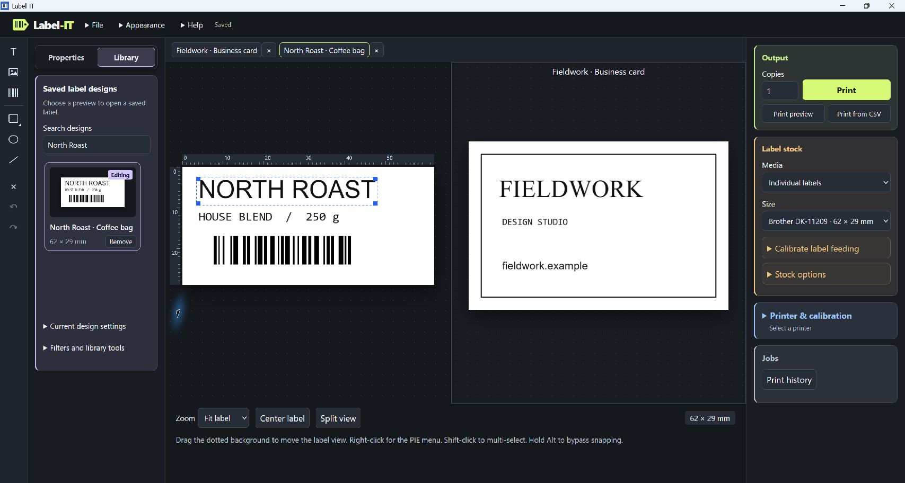
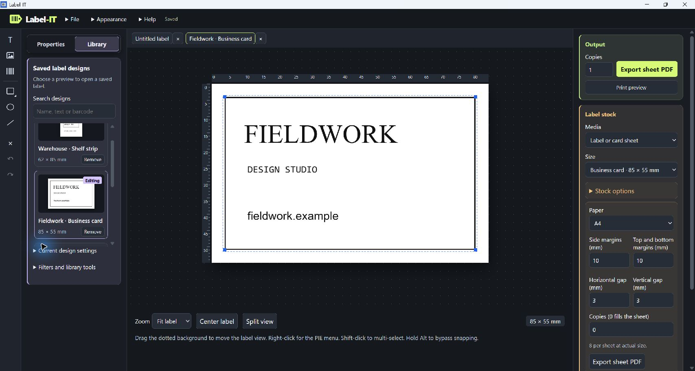
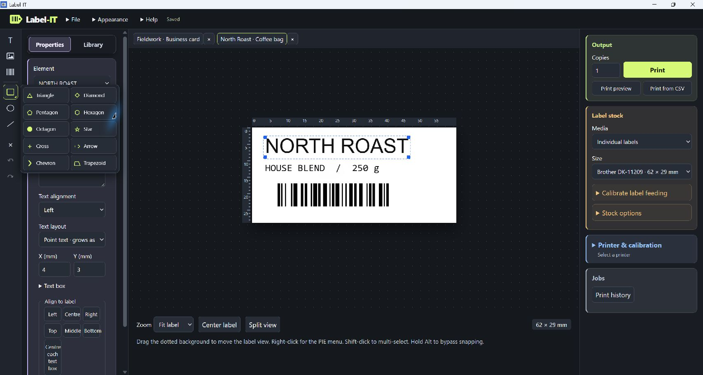
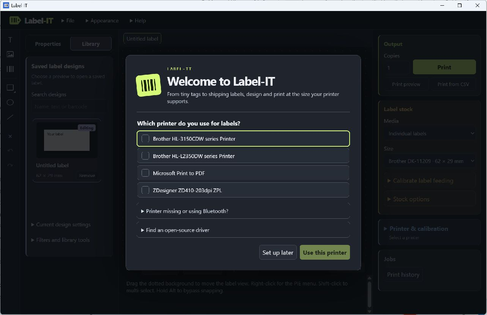
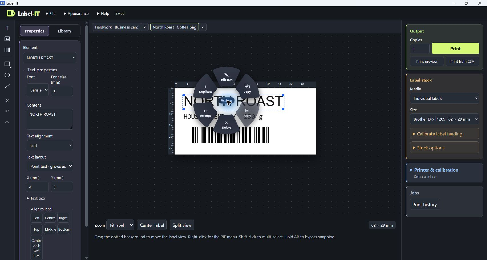

# Label-IT

Design, proof, and print labels at actual size. Use Label-IT for a single barcode, a sheet of address labels, or a batch of records. Open it from your desktop launcher or run the browser editor on your local network.

[](https://github.com/postmanpat-303/labelit/actions/workflows/frontend-checks.yml)

[**Download Label-IT 0.1.4**](https://github.com/postmanpat-303/labelit/releases/latest) · [Screenshots](#screenshots) · [Design-to-print workflow](#from-design-to-print) · [Browser and LAN setup](#open-in-a-browser) · [Give feedback](https://github.com/postmanpat-303/labelit/discussions/2) · [Report an issue](https://github.com/postmanpat-303/labelit/issues/new)

| Platform | Downloads | Setup |
| --- | --- | --- |
| Windows x64 | [Setup installer](https://github.com/postmanpat-303/labelit/releases/download/v0.1.4-preview/Label-IT-0.1.4-windows-x64-setup.exe) | [Windows instructions](#install-on-windows) |
| Linux x86-64 | [Debian package](https://github.com/postmanpat-303/labelit/releases/download/v0.1.4-preview/label-it_0.1.4_amd64.deb) · [Portable archive](https://github.com/postmanpat-303/labelit/releases/download/v0.1.4-preview/Label-IT-0.1.4-linux-x86_64.tar.gz) | [Linux instructions](#install-on-linux) |
| macOS · Apple silicon and Intel | [Universal DMG](https://github.com/postmanpat-303/labelit/releases/download/v0.1.4-preview/Label-IT-0.1.4-macOS-universal.dmg) | [macOS instructions](#install-on-macos) |

## Screenshots

### Two designs in Split view

Open several designs in tabs and click either pane to switch which design you’re editing. Each open design keeps its own zoom, position, and undo history during the session. Drag the dotted background to reposition the view, or select **Center label** to reset it.



<details>
<summary>More screenshots of sheet labels, shapes, printer setup, and the PIE menu</summary>

### Business cards and sheet labels

Start with a business-card preset or use your own label dimensions. Set margins and gaps for A4 or US Letter, then export an actual-size sheet PDF. This example fits eight 85 × 55 mm cards on A4.



### Shape tools

Use the left tool rail to add elements. Hold the rectangle icon to open ten more shapes, including stars, arrows, and polygons.



**Label editor**

Font and size controls sit at the top of the left panel. Label stock, printer settings, and print actions are on the right.


**First-run setup**

Choose an installed printer or come back to setup later.



**PIE menu**

Right-click a label element to open its properties, arrange it, duplicate it, or delete it.



**Thermal raster reference**

A full-label gradient on rounded 50 × 30 mm stock shows the stock, printer, and calibration controls together.


</details>

## From design to print

1. **Choose stock.** Start with a preset or enter the dimensions in millimetres. Choose individual labels, a sheet layout, or continuous roll media.
2. **Build the label.** Add text, artwork, shapes, and barcodes. Use the canvas and Properties panel for placement, or open two designs side by side in Split view.
3. **Proof a sample.** Preview the output and check the edges, text, and barcode. On supported Windows printer setups, print a calibration sample and save offsets for that printer and stock.
4. **Choose the output.** Send a job to a supported Windows printer, export an actual-size PDF for sheet printing, or map CSV columns to text and barcodes for a batch.
5. **Save and reuse.** Name the design, keep it in the local library, or export an editable copy. Back up the library when moving between devices or browser profiles.

## Install on Windows

Run the **Windows x64 setup executable** on Windows 10 or later. The installer checks for Microsoft Edge WebView2 and adds Label-IT to the Start menu. Select **Run Label-IT now** at the end of setup to open it maximised. The current preview installer is unsigned. Windows 10 is a compatibility target and still needs a clean-install test.

## Install on Linux

Choose the package matching your distribution and processor:

| Distribution | Easiest install |
| --- | --- |
| Ubuntu | Open the `.deb` in your software installer, or run `sudo apt install ./label-it_0.1.4_amd64.deb` from the download folder. |
| Fedora | Extract the x86-64 portable archive and run `sh install.sh`. |
| Arch and other desktops | Extract the x86-64 archive and run `sh install.sh` inside it as your regular user. The installer adds a launcher for your account. |

The Linux x86-64 build targets Debian 12 and glibc 2.34 or newer. The Debian package requires GTK 3 and WebKitGTK 4.1.

Find **Label-IT** in the **Office** category or search for it in your app launcher. Use **Help → Desktop shortcuts** to create a desktop shortcut. On GNOME, **Pin to dock** is available when the desktop allows it. On other desktops, right-click the app launcher and use its pin or add-to-panel command.

The Linux desktop build currently supports designing and exporting exact-size PDFs. In the system print dialog, select the matching stock and **Actual size**. Direct Linux printing is still in development.

To build packages from source on a Linux host with Node.js, Rust, and the [Tauri Linux prerequisites](https://v2.tauri.app/start/prerequisites/), run:

```sh
node build-frontend.mjs
cargo build --release --locked --manifest-path src-tauri/Cargo.toml --features custom-protocol
bash packaging/package-linux.sh src-tauri/target/release/labelit
```

Packages are written under `src-tauri/target/linux-packages`. The script always creates the per-user archive, creates a `.deb` when `dpkg-deb` is available, and creates an `.rpm` when `rpmbuild` is available. Build on the oldest release in the distro family you plan to support so the package can use that system’s runtime libraries.

To build the x86-64 Debian 12 compatibility packages in Docker, run:

```sh
docker build --platform linux/amd64 -f packaging/linux-bookworm.Dockerfile -t label-it-bookworm-amd64 .
docker run --rm --mount "type=bind,source=$PWD,target=/output" label-it-bookworm-amd64 \
  cp -a /packages/. /output/
```

The container builds the Debian package and per-user archive. The copy command places them in the current directory.

## Install on macOS

Download **Label-IT-0.1.4-macOS-universal.dmg** from the [0.1.4 release](https://github.com/postmanpat-303/labelit/releases/tag/v0.1.4-preview). Open the disk image and drag Label-IT into Applications. The app contains both Apple silicon and Intel binaries.

This preview uses ad-hoc signing. It has no Apple Developer ID signature or notarization, so macOS may block it under its security settings. GitHub Actions verified both architectures. A native installation and print test are pending. To print from this preview, export an exact-size PDF and choose **Actual Size** in the macOS print dialog.

## Windows desktop app

Install the [Tauri Windows prerequisites](https://v2.tauri.app/start/prerequisites/), then run these commands from the project folder:

```powershell
node build-frontend.mjs
cargo run --locked --manifest-path src-tauri/Cargo.toml --features custom-protocol
```

For a release build, use `cargo build --release --locked --manifest-path src-tauri/Cargo.toml --features custom-protocol` after staging the assets. Find the executable at `src-tauri/target/release/labelit.exe`. On the GNU toolchain, keep the generated `WebView2Loader.dll` alongside the executable. Rerun `node build-frontend.mjs` after changing the editor before building again.

To package the Windows x64 GNU release, run `packaging/package-windows.ps1` with NSIS available on your path, or pass `-Makensis` with the path to `makensis.exe`. The installer is written alongside the release executable. It installs for the current user, adds a Start menu shortcut, and leaves saved designs and lists in place when uninstalled. The installer checks for the Microsoft Edge WebView2 Runtime. This local release candidate is unsigned.

The desktop app keeps its design library in its own WebView2 storage. Existing designs in your regular browser are available in that browser.

The left panel contains the element tools, design library, and Properties. The right panel groups output actions, label stock, printer setup, calibration, and print activity into cards.

In **Printer setup**, choose a printer and enter the number of copies. **Print** or **Ctrl+P** sends the active design directly to that printer at the configured label size. The print job contains only the label artwork, with no browser headers or footers.

**Print activity** shows the latest job's Windows queue status. Use **Check queue** to refresh the status, or **Reprint last label job** to send the same artwork, stock size, printer and copy count again. Reprint is available until the app closes. A job that has left the queue may have printed or been removed.

**Cancel job** requests cancellation of the latest Label-IT job still in the Windows queue. Paper already fed by the printer may still print. **Print history** keeps recent jobs across restarts and lets you reprint individual labels and CSV batches up to 16 MB of raster data verbatim. For larger batches, reopen the saved list to recall the last printed range or choose a row to reprint.

For mailing lists or other records, make a design with text or barcode elements, then choose **Print from CSV**. Load a comma-separated UTF-8 file with a header row and match the columns to your design. Preview the data rows and choose the range to print. Label-IT checks the range for invalid barcodes and overflowing mapped text before submitting a single Windows print job with one label per row. The CSV does not change the saved design.

Choose the printer in the CSV dialog. The preview uses that printer’s saved resolution and offsets for the stock and warns if the offsets would clip a barcode or mapped text. The print range starts at row 1 only. Use **Select all rows** to include the whole list. When editing records, you can move between rows and return to your drafts. **Apply record changes** uses the edits for printing, and **Discard row changes** restores the applied values.

Use **Paste spreadsheet rows** to load copied cells directly. **Check range** lists the rows that need attention and lets you jump to each preview. **Print previewed row** prints just that record so you can check a sample or replace one label from a batch.

Choose **New address list** to start with address fields, or edit any list under **Find or edit records**. **Generate serial numbers** prepares sequential records with an optional date column. You can preview, save, export, and print generated rows like imported CSV data.

Use **Save list** to keep an imported list on this device. Choose it later from **Saved list** to reuse the records and the saved column mappings for the active design. **Export CSV** downloads the active list, including its column names.

Label-IT remembers **Print resolution**, **Feed offset**, and **Sideways offset** for each printer and stock size. Under **Calibrate stock**, print one test and compare the frame on the paper with the preview. Use **Move up** or **Move down** to preview a 0.1 mm adjustment relative to the last test. Print again to check the change, then choose **Looks good** to save it. Use **Enter measured gaps** to calculate feed and sideways corrections from all four margins.

Use **Printer and stock setups** to save or switch combinations in one place. **Print preview** shows the output raster with the printer offsets applied. Choose **Actual dots** to inspect it at one display pixel per raster dot.

Set **Corner radius (mm)** in **Label stock** to match rounded stock, or use 0 for square corners. Label-IT masks artwork outside the curve in the print raster and PDF. **Print tone** defaults to black-and-white thermal dots for Zebra queues and driver-managed colour for other printers. Preview, direct print, and CSV jobs share the same raster processing. Physical tone and alignment still depend on printhead settings, stock, and calibration.

Choose **50 × 30 mm** for the stock tested on the Zebra ZD410. The labels are 50 mm wide by 30 mm along the feed, with an approximately 6 mm gap. The leading edges are about 36 mm apart.

On the tested ZD410 at 203 dpi, a feed offset of +3.6 mm and a sideways offset of +0.65 mm centred the calibration print. Two consecutive calibration labels showed no visible feed drift, and the Code 39 test label scanned successfully as `LT12`.

A two-row CSV batch also printed in order from one Windows queue job on the ZD410. Both Code 39 labels scanned successfully as `LT12` and `LT13`.

On this workspace's existing Rust GNU toolchain, add the local MinGW tools to the current PowerShell session before running Cargo:

```powershell
$env:Path = "$env:USERPROFILE\tools\w64devkit\w64devkit\bin;$env:Path"
```

## Technology

Label-IT uses Tauri 2 and Rust for the desktop app, with HTML, CSS, JavaScript modules, and Canvas for the editor. The frontend build uses Node.js. GitHub Actions checks the frontend on pushes and pull requests and builds the universal macOS preview on demand.

## Open in a browser

Run this from the project folder with Node.js 24, then open [Label-IT on this computer](http://127.0.0.1:4173).

```sh
node serve.mjs
```

To make the editor available to other devices on a trusted local network, start it on one computer with the command below. If the host prompts for firewall access, allow the chosen port on the private network.

```sh
node serve.mjs --lan
```

On each device, open the host computer’s LAN address on port 4173, for example `http://192.168.1.50:4173`. Bookmark the address or create a browser shortcut for one-click access. Keep the host running. This mode serves the editor over HTTP and is intended for a trusted LAN.

Each browser keeps its own designs. Use **Export design** or **Back up library** to move work between devices. Print a sheet from the client’s print dialog or export an actual-size PDF. Direct Windows printer controls are available in the Windows desktop build.

Use **Add image** for PNG, JPEG, or WebP files up to 10 MB. Adjust the image width in millimetres to resize it proportionally. **Add barcode** creates a Code 39 symbol. Use **Barcode format** in Properties to switch to Code 128, QR Code, or Data Matrix. Label-IT checks that a barcode fits with its quiet zone and flags undersized 2D codes for the selected output resolution. PDF output is grayscale.

For a photo, **Fit image to print area** leaves a safety margin. **Use full printable height** puts the whole photo as high as the label size, aspect ratio, rounded corners, and current printer offsets allow, without cropping or stretching.

In **Properties**, use **Align to label** to place a selected element against an edge or centre it. Label-IT warns when a barcode or its required blank margins extend past the label. For direct printing it also checks whether your printer offsets would clip the barcode.

In the left panel, click a thumbnail under **Library** to open a saved label. Use **New design** for a blank label, **Duplicate** to start from a copy, or **Design name** to rename it. Changes save automatically in this browser. Switch to **Properties** to edit the selected element.

Use **Search designs** to search by name, text, or barcode value. In the desktop app, **Ctrl+F** opens the search field. Mark the current design as a **Favourite** to keep it at the top, or use **Favourites only** to hide other designs.

**Library tools** lets you organise designs with folders and tags, reuse a design as a template, and remove designs and restore them from **Removed designs**. **Export design** produces an editable file with its artwork. **Back up library** includes designs, saved CSV lists, column mappings, and printer profiles. Restoring a backup adds its items and retains existing designs, lists, and calibration settings.


Right-click empty label space for the PIE insert menu. Each slice has a text label, and hovering or focusing it shows the full action in the centre. Right-click an element and choose **Arrange** to align it, change its layer, or lock it. Locked items can still be selected and copied. Use **Arrange → Unlock element** or the Properties panel to edit them again.

Shift-click elements to select several, then use **PIE → Arrange → Group selection** to move and align them together. Use **Ungroup** to edit them separately. The canvas zoom control returns to **Fit label** with one selection, and **Text box** in Properties sets wrapping, a fit height, and the minimum font size.

Press **Delete** to remove the selected element or group and **Ctrl+Z** to undo it. Delete edits characters while a text field has focus.

## Roadmap

- Expand the stock catalogue.
- **Android app.** Bring the label editor, saved designs, stock profiles, and CSV workflows to Android. Validate media setup, alignment, and barcode scans on supported printers. Start by testing one printer connection on real Android hardware, then expand support based on the results.

