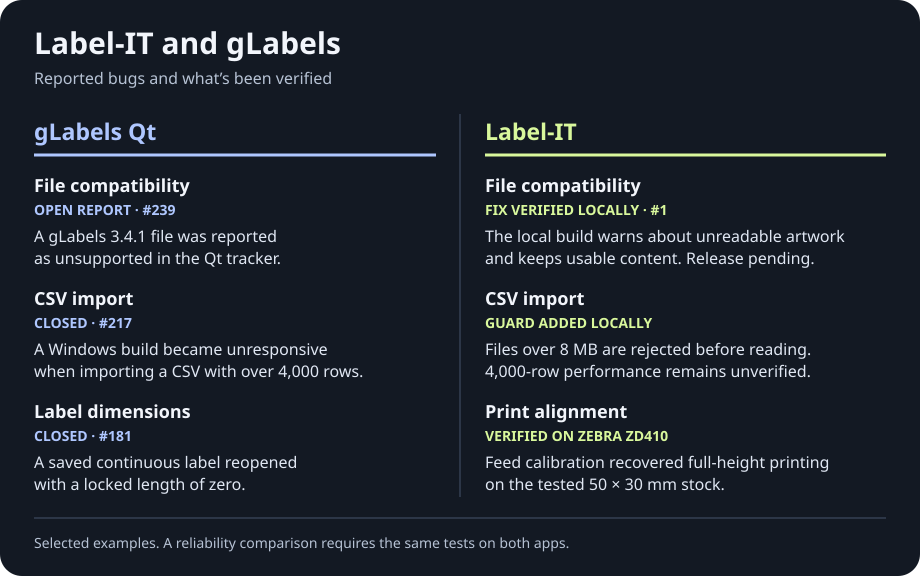

# Labelit

## Public preview

[Download Label-IT 0.1.0 Preview](https://github.com/postmanpat-303/labelit/releases/tag/v0.1.0-preview) for Windows or Linux.

[Download the Linux compatibility preview](https://github.com/postmanpat-303/labelit/releases/tag/v0.1.0-linux-compat) for the Debian 12 x86-64 package, AppImage, and per-user archive.

## What we built in days with AI

gLabels grew out of the GNOME desktop and gave us a model for stock templates and data merge. Label-IT started with a smaller goal: make it easier to design, align, and print a label on a desktop thermal printer. With AI helping write and iterate on the code, a few days took us from a prototype to a public Windows and Linux preview.

- **What we shipped.** A millimetre-scale editor, printer-aware stock suggestions, and import for compatible gLabels designs. The Windows preview supports CSV batch printing. Linux users can export exact-size PDFs for printing through their system dialog.
- **What hands-on testing caught.** On a Zebra ZD410, a 50 × 30 mm photo label clipped at the top and left a blank strip at the bottom. Measuring the actual prints helped us get full-height output and refine the live calibration workflow, which lets users nudge the position by 0.1 mm.
- **How to help.** Try the preview and share your printer model, label size, and results in [GitHub Issues](https://github.com/postmanpat-303/labelit/issues). The project welcomes feedback. The app source and its licence are still pending publication.

## Bug comparison

Reports: [gLabels file compatibility](https://github.com/j-evins/glabels-qt/issues/239), [gLabels CSV import](https://github.com/j-evins/glabels-qt/issues/217), [gLabels label length](https://github.com/j-evins/glabels-qt/issues/181), and [Label-IT embedded artwork](https://github.com/postmanpat-303/labelit/issues/1).

## Original design notes

The following notes capture the initial research and roadmap.

**A friendly, driver-free label designer for thermal printers.** Every standard size out of the box, any custom size you can measure, and data entry that feels like a spreadsheet — not a config panel.

> Status: design & research phase. See [`docs/RESEARCH.md`](docs/RESEARCH.md) for the open-source landscape and [`docs/IDEAS.md`](docs/IDEAS.md) for the feature brainstorm.

## Why

Printing a label should take ten seconds: pick a size, type, print. Today it means vendor apps (Dymo Connect, P-touch Editor) that are heavy, locked to one brand, and allergic to CSV files. Labelit is the opposite: brand-agnostic, offline-first, and happy to print one label or a thousand.

## Design pillars

1. **Zero drivers, zero cloud.** Raw USB / Bluetooth / network from the app. No vendor software, no accounts, no telemetry.
2. **Millimetre-true canvas.** What you see is what prints — real-world units, rulers, snap guides, 203/300 dpi aware.
3. **Every size + your size.** Built-in library of Brother DK, Dymo LabelWriter, Zebra and Avery geometries, plus a custom-size editor (width, height, gap, shape) saved to your library.
4. **Data entry for humans.** Single-label quick form, spreadsheet-style batch grid, CSV/XLSX import, clipboard paste, auto-serial numbers, `{{variables}}` that merge into any element.
5. **Keyboard-first.** Tab through fields, `Cmd+P` prints, everything reachable without a mouse.

## Stack (current direction)

- **Shell:** Tauri 2 (Windows / macOS / Linux, tiny footprint)
- **UI:** React + TypeScript, Konva for the canvas, Zustand for state
- **Barcodes:** JsBarcode + bwip-js (Code128, EAN-13, QR, DataMatrix…)
- **Print core (Rust):** raw USB (`rusb`), BLE (`btleplug`), network sockets; emitters for Brother raster, ZPL, TSPL, EPL, ESC/POS
- **Browser fallback:** the same UI ships as a PWA using WebUSB / WebBluetooth where the platform allows, with PDF export as the universal last resort

## Inspiration

Built on the shoulders of the open-source label community — full notes in [`docs/RESEARCH.md`](docs/RESEARCH.md):

| Project | What we take from it |
|---|---|
| [niimblue](https://github.com/MultiMote/niimblue) | Proof that a browser app can own a printer end-to-end |
| [brother_ql](https://github.com/pklaus/brother_ql) + [brother_ql_web](https://github.com/pklaus/brother_ql_web) | Brother QL raster protocol, media detection |
| [gLabels](https://github.com/j-evins/glabels-qt) | The classic: template library + merge model |
| [Vue-Print-Designer](https://github.com/0ldFive/Vue-Print-Designer) | Visual designer with variables & templates |
| [thermoprint](https://github.com/tomLadder/thermoprint) | Konva editor + platform-agnostic TS core |
| [labelize](https://github.com/GOODBOY008/labelize) / [portakal](https://github.com/productdevbook/portakal) | Multi-language printer command emission |
| [QZ Tray](https://github.com/qzind/tray) | The bridge pattern we're replacing with direct I/O |
| [JsBarcode](https://github.com/lindell/JsBarcode) / [bwip-js](https://github.com/metafloor/bwip-js) | Barcode symbologies |
| [pylabels](https://github.com/bcbnz/pylabels) | Avery sheet geometry for PDF export |

## Roadmap sketch

- **M1 — Designer:** canvas, size library, custom sizes, text/image/barcode elements, undo/redo, PDF export
- **M2 — Print:** Brother QL + ZPL/TSPL emitters over USB/network, print queue, media detection
- **M3 — Data:** batch grid, CSV/XLSX import, serials, `{{variables}}`
- **M4 — Polish:** template gallery, calibration tool, i18n, sheet imposition

## Contributing

Not yet — the repo is in the idea phase. Watch it, or open an issue with a label size or printer you care about.
